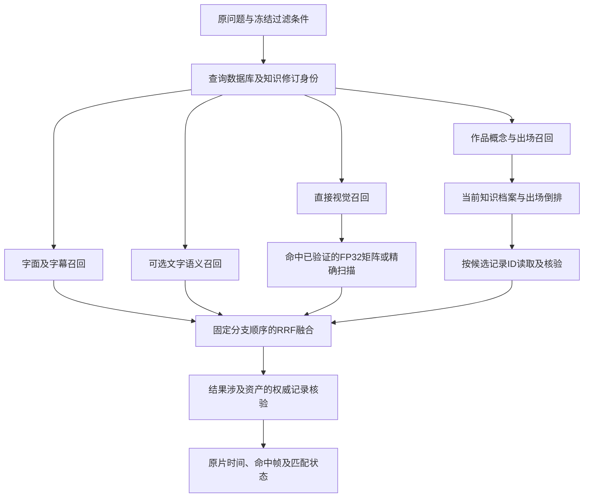

# 查询性能优化与知识召回接口（2026-10-28）

本次优化直接视觉查询和混合搜索的执行路径：复用已验证的向量矩阵、并行召回、按实体出场索引读取候选，并缩小HTTP结果的权威资料读取范围。基础模型、图像特征、FP32计算、既有概念关键词评分和RRF融合规则保持原有语义。

**五组配对实测通过结果等价门槛：5,280次请求的完整响应一致。** 热原生查询中位耗时从47.49 ms降至12.86 ms，降低72.93%；HTTP接口从188.25 ms降至152.77 ms，降低18.85%。首次纯视觉查询构建缓存略有额外成本，详见下表。性能和检索质量结论仅适用于文中列出的实验范围。

## 当前执行流程



查询理解、可选重排和视觉复核保留现有开关；本次没有启用新的远程模型调用。基础搜索的耗时与可选生成式步骤分别计量。

## 矩阵缓存与失效规则

`VisualIndex` 使用默认256 MiB的有界LRU。缓存键包括数据库身份、视觉命名空间、持久查询修订、过滤条件及参数；不同查询文本可以复用同一过滤范围的矩阵。它与“文本查询向量缓存”分别工作：后者只省去文本编码，前者省去反复读取向量BLOB、解析全部窗口JSON及构建NumPy矩阵。

快照在同一SQLite只读事务中构建，先验证窗口证据摘要、向量维度和有限数值。缓存保留原SQL遍历顺序及每512行的FP32矩阵块，继续计算每窗口的最佳帧分和既有并列顺序。矩阵只读，结果从保存的记录内容重新生成，调用者的融合与展示修改不会污染后续查询。

查询修订使用持久表及写入触发器，覆盖记录、文字语义命名空间、视觉命名空间、向量、窗口关联及FTS内容变化。另一连接或另一搜索实例的写入也会失效快照。`visual_query_cache` 的写入不触发失效。任务调度已有的 `_generation` 继续负责其发布契约，没有被查询缓存版本替代。

相同缓存键的并发构建会合并；构建也有边界，避免并发未命中无限分配矩阵。保留内存统计包含向量和关联元数据，超预算或内存分配失败时走原来的精确扫描。内部 `search.visual_index.matrix_cache.max_bytes = 0` 可关闭缓存，`clear()` 可用于测量首次构建成本。这些是测试与运维接口，没有新增面向用户的模型选项。

如果同一过滤范围包含10万条768维FP32向量，仅向量负载就约293 MiB，已超过256 MiB默认预算；该范围将回退精确扫描。缩小作品或资产范围后可能重新满足缓存预算。默认配置不会通过减少候选、降低精度或采用近似搜索来满足内存上限，因此不能宣称所有规模都获得相同加速。

## 并发、恢复与HTTP结果核验

查询理解结束后，字面、可选文字语义、视觉和概念四路独立运行，各自收集候选与降级信息。融合固定按原分支顺序执行，不根据完成先后排列；原问题和过滤条件均保留。RRF采用现有常数60及既有候选上限。

查询核对数据库、知识和编码配置身份，更新期间最多重试一次召回；同次重试复用已得到的查询向量。持续变化返回HTTP 409和重试提示。预期的可选分支故障降级，未预期异常和取消会清理其他已启动任务；阻塞数据库和矩阵读取使用可等待线程清理的执行器。模型调用仍受原有配置与资源约束。

可选文字语义分支的完整SQL记录读取、Lance连接、开表及查询也在线程执行器中运行。门控回归直接阻塞这两个实际读取阶段，确认视觉分支仍能启动，且取消请求会等待正在执行的读取结束；同时确认一次版本重试只调用一次查询embedding。四路完成顺序反转时，同分候选顺序和完整响应保持一致。

HTTP接口通过索引中的记录ID确定资产归属，同时考虑合并成员与字幕上下文的来源ID。随后只对涉及的资产读取当前 `Library.records(asset_id)`，继续核对最新原文、人工修订、角色与概念绑定、命中帧及事件回跳。生成结果自报的资产ID不能决定读取范围；删除的记录不能靠旧候选恢复。

引擎内部计时与HTTP总耗时必须分别报告。HTTP路径还包含上述权威资料读取、结果处理及可选视觉核验，不能把搜索引擎的矩阵加速直接当成界面端到端加速。

## 实体出场索引与后续知识接口

`WorkEntityRecall` 默认使用64 MiB有界缓存，保存当前作品知识快照及“概念ID→已确认绑定→资产/记录ID”的倒排。缓存身份包含作品档案修订、文件身份和成员关系；源资产指纹仍从当前资料读取。概念撤销、绑定撤销、改名、成员变化或文件替换后不会继续使用旧快照。

档案中的绑定是权威数据，搜索记录中尚未刷新的 `concept_bindings` 不能代替它。因此直接修改知识存储、新绑定尚未同步到搜索投影时，新路径仍按旧遍历路径的方式读取最新绑定。查询继续使用原概念评分、每作品前5个概念及最终前50条候选，完成原片指纹、观察摘要、确认状态和原过滤条件校验后才截断。

内部 `KnowledgeRecallProvider` 协议提供两个同步操作：

- `revision(filters, engine)`：返回本次范围的知识修订身份，参与查询的一致性校验。
- `search(query, filters, engine)`：返回经过当前知识投影的候选，由搜索引擎再次按候选ID核对过滤范围及当前证据。

默认实现还将快照读取、候选引用生成和证据投影拆开，便于后续加入知识语义检索或关系解析。旧的 `concept_lookup` 回调和 `WorkEntityStore.search_occurrences(..., eligible_records=...)` 保留兼容入口。出场索引是可丢弃运行时数据，没有更改正式知识JSON格式，也不要求重算图像特征。

知识事实只帮助识别概念和出场。“道具能够停止时间”不能证明“当前正在停止时间”；知识分支保持 `setting_concept_appearance`、`event_verified=false` 和 `partial`。跨作品同名实体仍受作品范围限制。后续若采用独立知识文本模型，应按实体/记录ID融合结果；跨库检索若使用不同模型或不兼容向量空间，原始分数不能直接混算。

## 同批查询复现与验收

基线冻结的是本轮修改前、已经包含上一轮入库优化的源码。使用同一个90秒《超时空辉夜姬》片段建立的533条视觉向量及原8问；无需重新解码视频或编码图片。基线和新版均使用隔离索引副本，模型预热、配对轮次、文本缓存与矩阵缓存状态单独记录。

该基线对应入库优化提交 `f7fb2d5` 的应用源码；本地实验实际使用修改前冻结的工作树副本，并保存逐文件SHA256，不以旧的 `029c390` 代替。复现时可将 `f7fb2d5` 检出到独立目录，用同一依赖环境和同一份只读实验资料库运行脚本。查询清单的最小结构为 `{"clips":[{"asset_id":"测试资产ID","queries":[{"query":"问题文本"}]}]}`，原8问文本随精简结果发布。

可复用脚本为 [`scripts/benchmark_queries.py`](../scripts/benchmark_queries.py)。从仓库根目录运行，路径需指向自己的隔离实验数据：

```powershell
.venv-windows\Scripts\python.exe scripts/benchmark_queries.py `
  --baseline-root "<冻结基线源码目录>" `
  --current-root "." `
  --source-library "<隔离测试资料库>" `
  --encoder-config "<本地图文编码器配置>" `
  --manifest "<原8问清单>" `
  --output-dir "<新的实验结果目录>" `
  --pairs 5 --repeats 20
```

脚本拒绝覆盖既有结果目录，各工作进程只导入指定的一套实现，禁止远程模型调用。大型视频、模型、隔离库和完整原始响应保存在已忽略的实验目录；仓库发布精简结果及复现脚本。

三种测量分别为基础搜索引擎、直接视觉召回和ASGI HTTP接口；后者经过真实中间件、路由、权威投影和JSON响应，不包含套接字传输及浏览器渲染。原8问未启用远程文字embedding、查询理解、生成式重排或视觉核验，因此其时延不包含这些可选模型调用。内存记录区分矩阵缓存保留字节、主应用进程结束RSS及进程生命周期峰值；进程数值包含基准记录开销，不包含独立编码器子进程。

验收比较包括Top5/Top50顺序、分数、命中帧、回跳时间、证据ID、融合分支和匹配状态。原8问包含开发集标注偏差，本次用于输出等价验证，不据此重新宣称整体语义准确率。另以实体绑定样例核对旧遍历与倒排结果，并用1万、10万向量合成规模测试检查缓存容量和回退；合成规模数据不支持真实检索质量结论。

专项回归覆盖跨512行块的同分向量、空范围及小作品过滤；独立连接写入、回滚、删除、源变更及模型命名空间失效；矩阵LRU、禁用、超预算、内存分配失败和并发单次构建；知识绑定新增与撤销、成员变化及未刷新投影；HTTP合并成员、字幕来源、人工纠错及事件证据复核。HTTP最后一次版本核对若发现变化，直接返回409，避免重复已执行的可选视觉核验。

## 五组正式实测

每组交替调整基线与新版的先后顺序；每条热查询重复20次。每种执行路径各有800次基线热请求、800次新版热请求；另有两种未缓存条件，各40次/实现/路径。总计5,280次请求，全部公开字段（包括顺序、分数、证据及匹配状态）的SHA256一致，各组实现源码哈希稳定。

| 热查询路径 | 基线中位数 / p95（ms） | 新版中位数 / p95（ms） | 中位数降低 |
| --- | ---: | ---: | ---: |
| 基础搜索引擎 | 47.49 / 74.41 | 12.86 / 15.62 | 72.93% |
| 直接视觉召回 | 17.88 / 22.75 | 5.89 / 7.43 | 67.04% |
| HTTP接口（ASGI） | 188.25 / 221.63 | 152.77 / 194.67 | 18.85% |

原生热查询达到“中位数至少降低20%”的目标，三种路径的p95均下降。HTTP仍承担权威证据投影和响应处理，收益小于引擎内部收益。

| 缓存条件 | 路径 | 基线中位数 / p95（ms） | 新版中位数 / p95（ms） |
| --- | --- | ---: | ---: |
| 矩阵首次构建、文本未缓存 | 基础搜索引擎 | 70.13 / 499.47 | 44.31 / 459.80 |
| 矩阵首次构建、文本未缓存 | 直接视觉召回 | 38.15 / 42.84 | 39.94 / 44.28 |
| 矩阵首次构建、文本未缓存 | HTTP接口 | 223.07 / 245.73 | 199.38 / 231.36 |
| 矩阵已缓存、文本未缓存 | 基础搜索引擎 | 67.17 / 92.94 | 29.94 / 35.34 |
| 矩阵已缓存、文本未缓存 | 直接视觉召回 | 36.27 / 43.76 | 26.75 / 32.24 |
| 矩阵已缓存、文本未缓存 | HTTP接口 | 202.04 / 243.02 | 168.75 / 198.96 |

表中“首次构建”是整次请求耗时，包含未缓存文本编码，并非单独的矩阵分配计时。纯视觉首次请求增加1.79 ms（4.69%）；新进程原生首题还包含jieba首次初始化，因此原生冷条件的高p95不能全部归因于缓存构建。模型已提前暖机，操作系统文件缓存未清空。

真实索引缓存保留2,342,934字节（约2.23 MiB）；每个新版进程有24次主动清空后的构建、504次缓存命中，无超预算回退。主进程结束RSS的五轮中位数为176.89→179.18 MiB；五轮中最高的生命周期工作集峰值为220.29→202.27 MiB。这些进程值包含基准记录开销，不是单独的缓存占用，也不包含模型子进程。

新版原生热查询的分支中位数：字面10.55 ms、视觉7.71 ms、概念0.92 ms，内部总计12.84 ms。未配置文字embedding的分支只执行空分支判断，不能将其约0.003 ms当成文字模型速度；并发分支的时间也不能相加。HTTP中的权威记录读取中位数为130.53 ms，路由内部146.26 ms，整个ASGI请求152.77 ms。当前HTTP主要时间仍在结果证据的权威投影。

## 合成规模与实体样例

| 向量规模 | 热查询中位数 / p95：基线→新版（ms） | 首次请求：基线→新版（ms） | 新版保留矩阵缓存 |
| --- | --- | --- | --- |
| 1万 | 182.93 / 194.73 → 10.23 / 11.31 | 600.24 → 637.73 | 32.65 MiB |
| 10万 | 1886.40 / 1920.90 → 1845.63 / 1895.40 | 2217.94 → 3657.85 | 0，精确扫描回退 |

每档使用1组对照，每实现首次1次、热查询20次，42次完整Top50响应一致。10万向量超出256 MiB预算；首次尝试构建后才回退，多花约1.44秒，后续相同版本与范围直接回退，热性能基本持平。该档主进程峰值200.78→387.91 MiB：预算限制保留的缓存条目，不是整个进程或构建期间的内存上限。这里如实保留首次成本，不将10万规模称作获得明显加速。

实体样例包含301条可检索记录、1条经过证据校验的确认绑定和4个问题，每问题首次1次、热查询20次。旧遍历与倒排共168次完整响应一致；热召回中位数8.39→2.43 ms，p95 9.00→2.71 ms。该样例用于验证候选范围缩小及绑定机制，不是影片实体识别准确率评测。

规模测试使用 `--scale-worker --vectors 10000`（或 `100000`），分别指定基线和新版 `--implementation-root`、`--label`、相同 `--source-library` 及各自新的 `--output-dir`；实体样例使用 `--entity-benchmark --implementation-root . --output-dir <新目录>`。均使用 `--repeats 20`。精简的[配对结果、来源哈希、环境、内存及阶段计时](benchmarks/query-optimization-20261028.json)已纳入仓库，另包含原8问逐题的热查询中位数和p95（每实现、每路径、每题100次），不包含本机私有路径或完整影片记录。

## 发布验收

最终冻结源码的完整后端回归：**1,991项通过、100项跳过、47个子测试通过**，耗时669.42秒；其中包含上一轮PyAV抽帧、连续解码、编码预取、恢复和模型身份兼容测试。前端完整回归**341项、33个文件通过**，TypeScript检查与Vite生产构建通过；全项目Ruff和差异检查通过。

本轮还修复了测试中的两类旧假设：SQLite快照按只读事务中的逻辑数据及schema比较，避免WAL检查点引起物理文件哈希误报，同时仍检测真实数据变更；HTTP候选测试显式建立索引归属后再验证证据。CI以 `python -m pytest` 启动，与本地一致地将仓库根目录纳入模块路径，修复原先 `scripts` 导入导致的收集失败。

入库优化和查询优化分别提交至 `main`。推送触发的远程检查可在[Cross-platform checks](https://github.com/Vege114/SceneRecall/actions/workflows/ci.yml)核对具体提交。最终本地原始日志位于忽略目录 `test-results/query-optimization-20261028/`，只有脱敏摘要和可复现脚本纳入仓库。

相关历史记录：[入库流水线优化](RETRIEVAL_PIPELINE_OPTIMIZATION_20261028.md)、[外部项目对照](AUTO_SCENES_COMPARISON_20261028.md)。历史测量保留原口径，不用查询优化结果覆盖入库耗时或外部项目的测试结果。
