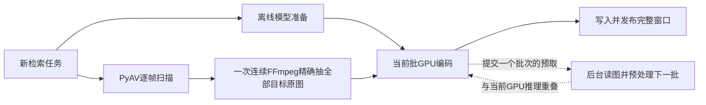

# 检索入库流水线优化（2026-10-28）

本次针对 `retrieval-first-v1` 的流程安排提速：接入已有 PyAV 扫描器，精确原图提取改为一次连续解码，模型准备与扫描并行，下一批CPU读图/预处理与当前GPU编码重叠。没有更换模型、降低采样密度、改变batch16、切换图像预处理或压缩检索证据。

本文保存当次实验的历史结果。下文 `test-results/` 下的原始日志、测试数据和实验脚本属于本地忽略目录，**未随仓库发布**；代码标记中的路径均相对于仓库根目录，仅供保留该实验数据的环境定位。

## 执行路径

原路径：FFmpeg逐帧扫描 → 每128张重启FFmpeg抽原图 → 加载模型 → 每批依次读图、预处理、GPU推理、写库。

新路径：

扫描需要看后续画面才能确定最终采样，原图继续使用原有FFmpeg JPEG/color路径，以保留精确画面。**整体仍是扫描、精确抽图两遍解码**；本片原图抽取进程从5个减为1个，没有宣称已实现全流程单遍解码。

## 同片实测与质量证据

最终版本各跑三轮，任务耗时中位数从 **40.314秒降到25.926秒，减少35.69%**；相同任务吞吐为原来的1.555倍。首次视觉可搜从27.982秒降到17.910秒，提前约10.1秒。

| 项目 | 优化前 | 优化后 |
|---|---:|---:|
| 第1轮基础检索入库 | 40.314秒 | 25.560秒 |
| 第2轮基础检索入库 | 44.005秒 | 25.926秒 |
| 第3轮基础检索入库 | 39.597秒 | 27.981秒 |
| **任务中位数** | **40.314秒** | **25.926秒** |
| 首次视觉可搜中位数 | 27.982秒 | 17.910秒 |
| 采样抽图阶段中位数 | 15.291秒 | 13.415秒 |
| 视觉索引阶段中位数 | 21.936秒 | 8.664秒 |
| 编码帧数/存储向量数 | 533/533 | 533/533 |
| PyTorch峰值分配 | 856,508,928字节 | 856,508,928字节 |

任务计时在应用顶层模块导入后开始，包含实际模型准备、处理及写盘。模型准备已与采样重叠，不能再与阶段耗时相加。每轮预取命中33次，OOM重试0。查询没有作为本轮提速收益：原生未缓存42.45→47.74毫秒、重复23.88→25.86毫秒，纯视觉未缓存37.32→40.20毫秒、重复17.76→19.81毫秒；实测增加约2–5毫秒，不能直接断定完全是噪声。

最终比较为 comparison-baseline-vs-optimized-final.json（`test-results/retrieval-optimization-20261028/comparison-baseline-vs-optimized-final.json`），完整计时边界见测量说明（`test-results/retrieval-optimization-20261028/MEASUREMENTS.md`）。初版测试记录保留，最终数字使用 `optimized-final`。

使用上一轮相同的90秒《超时空辉夜姬》无损片段、同一SigLIP2固定revision、CUDA FP16、batch16、同一采样参数与8问。优化前从Git归档加载应用和模型worker，防止与正在修改的代码混用；各轮均新进程、空隔离库，图像向量缓存命中0。操作系统文件缓存没有清空，不称磁盘冷启动。正式库只读。

三轮最终测试的以下输出**全部完全一致**，向量最大绝对误差0；每侧共比较1599次原图/向量输出及144行查询：

- 采样参数、533个帧ID、源PTS、时间基、镜头和窗口内容。
- 每张原图JPEG的SHA256，以及解码后的完整RGB像素SHA256。
- 全部533条768维FP32检索向量逐bit比较。
- 8问×原生/纯视觉×3次重复的Top5顺序、分数、命中帧与回跳时间，每轮48行。

新计划ID按冻结的解码器区分，`decoder_profile` 和执行计时字段属于预期的执行身份变化，不算质量变化；帧ID和实际证据仍严格比较。旧开发集存在时间区间标注偏差，本次不拿它重新推算总体准确率。

## 具体实现与边界

1. **PyAV接入与冻结配置**：新检索任务默认 `pyav-libavfilter-v1`。已有任务继续使用冻结的解码器；没有该字段的旧任务按FFmpeg解释。PyAV和FFmpeg计划缓存分开，旧计划的路径及恢复规则保留，防止跨解码器误复用。
2. **一次精确抽图**：`extract_keyframes_stream()` 接受整份目标计划，用滤镜文件避免Windows命令行长度上限。JPEG流式写临时文件，核对全部PTS及源身份后再发布，不把整部视频原图留在内存。普通 `extract_keyframes()` 的256张上限保留。连续抽图按600秒无进展超时处理，避免把整部长片限制为旧单批的600秒总预算；取消仍回收FFmpeg。
3. **模型准备并行**：加载本地模型与扫描/抽图并行，不生成dummy图片、文本向量或可搜索证据。任一路失败或任务取消，会取消并等待另一条路径清理，避免遗留模型任务或解码进程。
4. **有界编码预取**：4线程按原顺序读图，使用原来的批预处理；只保留下一批CPU输入。当前批GPU推理时准备下一批，GPU调用仍由worker主线程串行执行。路径、裁剪及文件大小/修改时间必须匹配才消费预取；父层在编码、发布前后继续检查文件。
5. **OOM与资源回收**：只重试失败GPU子批，减半后使用对应CPU张量切片，不重复已完成推理。异常、EOF和取消均回收预取和线程。模型、精度、归一化、文本长度保护及返回向量顺序保留。
6. **既有向量空间兼容**：实际实现文件哈希仍计入模型身份。仅本次已验证等价的新旧源码指纹及LF/CRLF形式可复用向量空间，权重、预处理、tokenizer、设备、精度和依赖身份仍须完全匹配；未知后续代码改动继续隔离。只读核对正式库既有namespace可被识别，不需要因本次调度优化重建整库。兼容证据见production-cache-compatibility.json（`test-results/retrieval-optimization-20261028/production-cache-compatibility.json`）。

真实SigLIP2样本的串行读图、并行读图、后台预取及OOM半批切片，`pixel_values` 逐元素一致，最大误差0，见独立张量验证（`test-results/retrieval-optimization-20261028/encoder-preprocessing-equivalence.json`）。相关回归覆盖精确PTS、257张JPEG逐字节等价、VFR、非零起点、旋转、源变更、取消、失败恢复、旧缓存及旧任务配置。

最终核心回归 **113项通过**，日志见 pytest-final-core.log（`test-results/retrieval-optimization-20261028/pytest-final-core.log`）；媒体、解码器及工作流针对性测试组 **85项通过**。两个测试组有重叠，不能相加为独立测试总数。Ruff与`git diff --check`通过。

临时图片继续落盘，整个抽图计划会先在临时目录验证，因此长片可能比旧分批方式需要更多临时磁盘空间；这不改变保留的原图总数。本次仍有进一步优化读写和中间表示的空间，没有通过丢帧或减少证据换速度。

## 记录位置

- 全部原始记录（`test-results/retrieval-optimization-20261028/`）
- [上一轮外部项目对照](AUTO_SCENES_COMPARISON_20261028.md)
- 基线取证（`test-results/retrieval-optimization-20261028/baseline/summary.json`）
- 逐帧、向量和查询比较脚本（`test-results/retrieval-optimization-20261028/compare_results.py`）
- 同片复现脚本（`test-results/retrieval-optimization-20261028/run_benchmark.py`）

这些结论限定于本片及相关回归，未外推整集HEVC吞吐、其他模型或更大资料库的质量。没有修改正式库中的分析结果、人物参考或人工修订。
